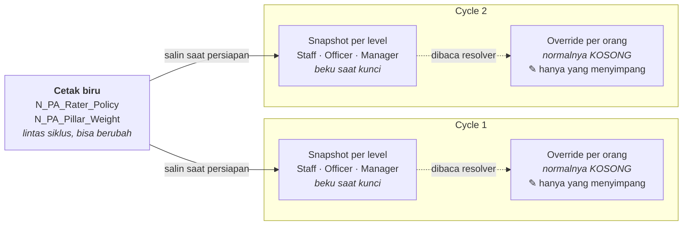

# Rencana Cycle dan Salinan Beku Peserta Performance Appraisal

> **Status:** checkpoint konseptual saja. Dokumen ini tidak mengizinkan pembuatan
> DDL, DML, migration, registry, kode aplikasi, SQL Tracker, atau perubahan database.

> **Prefix:** seluruh tabel PA memakai `N_PA_*`. Tiga tabel hasil DDL-2026-064
> (`N_PA_Rater_Policy`, `N_PA_Rater_Category`, `N_PA_Rater_Policy_Detail`) sudah memakai nama
> itu di development, dan nama tersebut final.

## Keputusan tinjauan 2026-08-30

Bagian 9 dokumen ini semula memuat sepuluh pertanyaan. Tujuh sudah dijawab user
pada tinjauan 2026-08-30 dan **tidak boleh ditanyakan ulang**. Nomor K merujuk
tabel keputusan di `2026-08-29-performance-appraisal-design.md`.

| Pertanyaan lama | Jawaban | Ref |
|---|---|---|
| #1 Lingkup perusahaan | Tidak dimodelkan dulu. Bentuk sekarang sudah benar. | K20 |
| #2 Tanggal acuan organisasi | Tetap satu tanggal eksplisit di Cycle. | — |
| #3 Status Cycle | Tetap; `LOCKED` berbeda dari `OPEN`. | — |
| #4 Cycle bersamaan | **Sudah ditutup sejak awal:** tumpang tindih dilarang, dijaga per karyawan. | K04, G1 |
| #5 Cakupan Policy | Tiap peserta tepat satu Policy dari level; level diambil lewat view golongan. | K19 |
| #6 Tingkat salinan | Satu salinan Policy per (Cycle, level); peserta menunjuk kepadanya. | — |
| #7 Pembentukan peserta | **Freelance dan Direktur ikut dinilai.** | K08 |
| #8 Sumber organisasi | Kondisi pada tanggal acuan sudah cukup. | — |
| #9 Penulisan relasi organisasi | Diisi lewat endpoint konverter dari approval flow. | K21 |
| #10 Publikasi | Dipertahankan konseptual; kolom fisik ditunda. | — |

Satu keputusan baru lahir dari tinjauan ini: **bobot di dalam satu kategori
penilai ditetapkan per peserta oleh admin** (K18). Konsekuensinya dijabarkan di
bagian 7.

## Kamus istilah

| Istilah teknis | Istilah bisnis di dokumen | Arti |
|---|---|---|
| Cycle | Cycle | Satu pelaksanaan appraisal dengan periode dan jadwal tertentu. |
| Policy | Policy | Blueprint aturan penilai yang sudah dibuat pada change 064. |
| Snapshot | Salinan beku | Nilai yang disalin ke Cycle dan tidak ikut berubah saat master berubah. |
| Participant | Peserta | Karyawan yang masuk atau dikecualikan dari Cycle. |
| Rater Assignment | Penugasan penilai | Keputusan final siapa menilai peserta pada kategori tertentu. |

## 1. Rekomendasi

Tabel berikutnya sebaiknya **`N_PA_Cycle`**, yaitu header Cycle yang
menjelaskan appraisal apa yang dijalankan, periode yang dinilai, jadwal pengisian,
dan statusnya. Tabel ini tidak sebaiknya dibangun sendirian. Sebelum tinjauan DDL,
paket desain minimumnya juga harus mendefinisikan salinan beku Policy dan peserta
agar Cycle yang sudah dikunci tidak bergantung pada Policy atau organisasi karyawan
yang masih dapat berubah.

Urutan yang direkomendasikan:

```text
N_PA_Cycle
  -> N_PA_Cycle_Rater_Policy_Snapshot        beku saat kunci
       -> N_PA_Cycle_Rater_Policy_Detail_Snapshot
  -> N_PA_Cycle_Pillar_Weight_Snapshot       TIDAK beku, boleh diubah lalu hitung ulang
  -> N_PA_Participant
       -> N_PA_Assignment       (fase berikutnya)
```

Empat tabel pertama membentuk batas persiapan Cycle. Penugasan Penilai menjadi
batas berikutnya setelah resolver organisasi dan alur tinjauan manual disepakati.
Payload penilaian, skor per butir, hasil agregasi, kalibrasi, dan komposisi KPI masih
di luar scope.

## 2. Mengapa Cycle menjadi tahap berikutnya

Tabel hasil change 064 adalah blueprint yang dapat dipakai ulang:

- target `N_PA_Rater_Policy` memilih aturan berdasarkan level HRIS dan versi;
- target `N_PA_Rater_Policy_Detail` menyimpan bobot kategori serta aturan jumlah penilai;
- target `N_PA_Rater_Category` mendefinisikan ATASAN/BAWAHAN/PEER/SELF.

Ketiganya belum menjawab karyawan mana yang mengikuti satu appraisal, versi
Policy mana yang dibekukan, atau kondisi organisasi mana yang berlaku. Cycle
membuat batas waktu tersebut. Baris peserta dan salinan beku Policy kemudian
menjaga histori saat karyawan pindah level/divisi/jabatan atau Policy direvisi.

## 3. Tabel A — `N_PA_Cycle`

### Tujuan

Satu baris untuk satu pelaksanaan appraisal. Tabel ini memiliki jadwal dan status
Cycle, tetapi tidak memiliki detail Policy, identitas peserta, penugasan penilai,
atau skor.

### Kolom konseptual — data utama

| Kolom | Tipe konseptual | Boleh kosong | Fungsi |
|---|---|:---:|---|
| `Id_PA_Cycle` | `int identity` | Tidak | Primary key; nama mengikuti entitas tabel teknis. |
| `Kode_Cycle` | `varchar(50)` | Tidak | Kode bisnis unik dan stabil. |
| `Nama_Cycle` | `nvarchar(150)` | Tidak | Nama tampil, misalnya PA Semester 1 2027. |
| `Deskripsi` | `nvarchar(500)` | Ya | Penjelasan lingkup atau kebutuhan operasional. |
| `Periode_Dinilai_Dari` | `date` | Tidak | Tanggal pertama kinerja yang dinilai. |
| `Periode_Dinilai_Sampai` | `date` | Tidak | Tanggal terakhir kinerja yang dinilai. |
| `Pengisian_Dari` | `datetime2` | Tidak | Waktu penilaian mulai dapat diisi. |
| `Pengisian_Sampai` | `datetime2` | Tidak | Due_At normal pengisian. |
| `Tanggal_Acuan_Organisasi` | `date` | Tidak | Tanggal efektif untuk membaca organisasi karyawan dan kandidat penilai. |
| `Cycle_Sumber_Id` | `int` | Ya | Self-FK ketika Cycle disalin atau dibuka ulang sebagai Cycle baru. |
| `Status_Cycle` | `varchar(20)` | Tidak | Status proses yang divalidasi aplikasi. |
| `Flag_Aktif` | `char(1)` | Tidak | Status administratif Y/T. |

`Tanggal_Acuan_Organisasi` tetap berada pada data utama karena nilainya menentukan
data organisasi dan kandidat penilai yang dipakai Cycle. Kolom tersebut bukan
tanggal audit.

### Kolom konseptual — lifecycle dan audit

| Kolom | Tipe konseptual | Boleh kosong | Fungsi |
|---|---|:---:|---|
| `Locked_At`, `Locked_By` | `datetime2` / `int` | Ya | Waktu dan aktor yang membuat seluruh salinan Cycle tidak boleh berubah. |
| `Published_At`, `Published_By` | `datetime2` / `int` | Ya | Waktu dan aktor publikasi hasil; kolom fisik dapat ditunda sampai lingkup publikasi disetujui. |
| `Created_At`, `Updated_At` | `datetime2` | campuran | Waktu audit, mengikuti DDL-2026-064. |
| `Created_By`, `Updated_By` | `int` | Ya | Aktor `KPI_Users.Id_Users`; NULL hanya untuk aktor sistem yang terdokumentasi. |

Kolom audit dan lifecycle memakai bahasa Inggris, kolom bisnis tetap Indonesia —
mengikuti pola `N_PA_Rater_Policy` yang sudah ada di database (`Berlaku_Dari` +
`Activated_At`). Nama Indonesia seperti `Dikunci_Pada` yang sempat dipakai draf
awal dokumen ini **tidak dipakai**.

Status **sudah ditetapkan** dan daftar resminya ada di tabel `N_PA_Cycle_Status`
(DDL-2026-069), bukan di dokumen ini:

```text
DRAFT -> PREPARED -> LOCKED -> OPEN -> CLOSED -> PUBLISHED -> ARCHIVED
```

`LOCKED` membekukan salinan Policy/peserta/penilai, sedangkan `OPEN` berarti masa
pengisian dibuka. Keduanya berbeda walaupun pada praktiknya dapat terjadi bersamaan.
`ARCHIVED` berarti siklus selesai lalu disimpan sebagai riwayat — berbeda dari
`Flag_Aktif = 'T'` yang mempensiunkan baris salah buat.

`KALKULASI`, `KALIBRASI`, dan `REVIEW` sengaja tidak ada (K28): kemajuan perhitungan
ada di `N_PA_Result.Status_Hasil` dan review memakai mesin approval generik.

### Validasi utama

- akhir periode penilaian tidak boleh sebelum tanggal awal;
- akhir pengisian tidak boleh sebelum waktu mulai pengisian;
- tanggal acuan organisasi normalnya tidak melewati waktu penguncian;
- kode Cycle harus unik;
- Cycle sumber tidak boleh menunjuk dirinya sendiri;
- tanggal dan salinan beku tidak boleh berubah setelah Cycle dikunci;
- tumpang tindih antar-Cycle belum dilarang sampai bisnis menentukan apakah
  scope berbeda boleh berjalan bersamaan.

## 4. Tabel B — `N_PA_Cycle_Rater_Policy_Snapshot`

### Tujuan

Membekukan header Policy terpilih untuk setiap Cycle dan level HRIS. Menyimpan
FK ke target `N_PA_Rater_Policy` saja tidak cukup karena blueprint masih dapat berubah di
luar Cycle yang sudah dikunci.

### Kolom konseptual

| Kolom | Tipe konseptual | Boleh kosong | Fungsi |
|---|---|:---:|---|
| `Id_PA_Cycle_Policy_Snapshot` | `int identity` | Tidak | Primary key; nama mengikuti entitas tabel teknis. |
| `PA_Cycle_Id` | `int` | Tidak | FK ke Cycle; dipertahankan agar nama FK selaras dengan tabel sumber. |
| `PA_Rater_Policy_Id` | `int` | Tidak | FK jejak asal ke versi Policy yang dipilih. |
| `ID_Level` | `bigint` | Tidak | Level yang dibekukan sebagai lingkup pemilihan Policy. |
| `Kode_Policy_Salinan` | `varchar(50)` | Tidak | Salinan kode bisnis Policy. |
| `Nama_Policy_Salinan` | `nvarchar(150)` | Tidak | Salinan nama Policy untuk tampilan historis. |
| `Versi_Policy_Salinan` | `int` | Tidak | Salinan versi Policy. |
| `Deskripsi_Policy_Salinan` | `nvarchar(500)` | Ya | Salinan makna Policy bila diperlukan untuk tampilan historis. |
| `Snapshot_At` | `datetime2` | Tidak | Waktu materialisasi salinan beku. |
| `Snapshot_By` | `int` | Ya | Aktor manusia atau NULL untuk job sistem yang terdokumentasi. |
| `Flag_Aktif` | `char(1)` | Tidak | Status administratif selama persiapan. |

Aturan yang disarankan adalah maksimal satu salinan aktif per
`(PA_Cycle_Id, ID_Level)`. FK sumber menjaga jejak asal, sedangkan kolom salinan
menjaga tampilan historis.

## 5. Tabel C — `N_PA_Cycle_Rater_Policy_Detail_Snapshot`

### Tujuan

Membekukan setiap aturan kategori penilai yang dipakai Cycle. Tabel ini menjadi
sumber aturan untuk penugasan peserta dan perhitungan berikutnya, bukan
`PA_Policy_Detail` yang masih hidup.

### Kolom konseptual

| Kolom | Tipe konseptual | Boleh kosong | Fungsi |
|---|---|:---:|---|
| `Id_PA_Cycle_Policy_Detail_Snapshot` | `int identity` | Tidak | Primary key; nama mengikuti entitas tabel teknis. |
| `PA_Cycle_Policy_Snapshot_Id` | `int` | Tidak | FK ke salinan header Policy dalam Cycle. |
| `PA_Rater_Policy_Detail_Id` | `int` | Tidak | FK jejak asal ke detail blueprint. |
| `PA_Rater_Category_Id` | `int` | Tidak | FK jejak asal ke master kategori penilai. |
| `Kode_Kategori_Salinan` | `varchar(40)` | Tidak | Salinan kode ATASAN/BAWAHAN/PEER/SELF. |
| `Nama_Kategori_Salinan` | `nvarchar(100)` | Tidak | Salinan nama kategori untuk histori. |
| `Organization_Relationship_Type_Id` | `int` | Ya | FK jejak asal type resolver; NULL untuk SELF. |
| `Kode_Relasi_Salinan` | `varchar(50)` | Ya | Salinan kode relasi agar hasil lama dapat direproduksi. |
| `Bobot_Persen` | `decimal(5,2)` | Tidak | Bobot kategori yang sudah dibekukan. |
| `Min_Rater` | `smallint` | Tidak | Jumlah minimum penilai yang sudah dibekukan. |
| `Maks_Rater` | `smallint` | Ya | Jumlah maksimum; NULL berarti tanpa batas. |
| `Min_Rater_Selesai` | `smallint` | Ya | Batas penyelesaian; NULL berarti semua penilai yang ditugaskan harus selesai. |
| `Flag_Izinkan_Manual` | `char(1)` | Tidak | Izin override manual yang sudah dibekukan. |
| `Urutan_Tampil` | `smallint` | Tidak | Urutan tampilan yang sudah dibekukan. |
| `Catatan_Aturan_Salinan` | `nvarchar(500)` | Ya | Salinan catatan aturan untuk tinjauan historis. |
| `Flag_Aktif` | `char(1)` | Tidak | Menandai detail dipakai atau dikecualikan saat persiapan. |

Tetap tidak ada kolom metode agregasi. Tetapi sejak K18, **penilai dalam satu
kategori tidak lagi otomatis berbobot sama**. Nilai kategori adalah rata-rata
**tertimbang** memakai `Bobot_Dalam_Kategori` pada baris penugasan masing-masing,
lalu dikalikan `Bobot_Persen` yang sudah dibekukan di sini.

Bobot rata tetap menjadi **baku**, bukan aturan: dua atasan tanpa penyetelan admin
berarti 50/50, dan hasilnya identik dengan rata-rata biasa. Yang berubah hanyalah
admin sekarang boleh menimpanya menjadi 70/30.

## 6. Tabel D — `N_PA_Participant`

### Tujuan

Satu baris untuk satu karyawan yang diikutkan atau secara eksplisit dikecualikan
dari Cycle, dengan kondisi organisasi dan Policy yang dibekukan saat persiapan.

### Kolom konseptual

| Kolom | Tipe konseptual | Boleh kosong | Fungsi |
|---|---|:---:|---|
| `Id_PA_Participant` | `int identity` | Tidak | Primary key; nama mengikuti entitas tabel teknis. |
| `PA_Cycle_Id` | `int` | Tidak | FK ke Cycle. |
| `PA_Cycle_Policy_Snapshot_Id` | `int` | Ya | FK ke salinan Policy yang berlaku; boleh kosong hanya untuk peserta yang dikecualikan atau belum teresolusi saat DRAFT. |
| `Kode_Perusahaan` | `varchar(3)` | Tidak | Bagian perusahaan dari identitas komposit karyawan. |
| `Kode_Karyawan` | `varchar(255)` | Tidak | Bagian karyawan dari identitas komposit; FK ke `Karyawan` selama sumber tersedia. |
| `Nama_Karyawan_Saat_Cycle` | `varchar(255)` | Tidak | Nama historis. Sumbernya `Karyawan.Nama varchar(255) NULL`, jadi butuh aturan pengganti bila kosong. |
| `ID_Level_Jabatan_Saat_Cycle` | `bigint` | Tidak | Nilai yang benar-benar melekat pada karyawan; sumber `Karyawan.ID_Level_Jabatan`. |
| `ID_Level_Saat_Cycle` | `bigint` | Tidak | Level yang dipakai memilih Policy. **Turunan**, di-resolve lewat `View_Golongan_Sub_Golongan_Level_Jabatan` (K19). |
| `Nama_Level_Saat_Cycle` | `varchar(100)` | Ya | Nama level saat Cycle disiapkan; sumber `nama_level` pada view golongan. |
| `ID_Divisi_Sub_Divisi_Saat_Cycle` | `bigint` | Ya | Identitas penempatan organisasi yang dibekukan; sumber `Karyawan.ID_Divisi_Sub_Divisi`. |
| `Nama_Divisi_Sub_Divisi_Saat_Cycle` | `nvarchar(...)` | Ya | Nama unit organisasi saat Cycle disiapkan. |
| `Nama_Jabatan_Saat_Cycle` | `nvarchar(...)` | Ya | Nama jabatan saat Cycle disiapkan. |
| `Status_Peserta` | `varchar(20)` | Tidak | Status proses peserta yang divalidasi aplikasi. |
| `Alasan_Dikecualikan` | `nvarchar(500)` | Ya | Wajib diisi ketika peserta dikecualikan. |
| `Snapshot_At` | `datetime2` | Tidak | Waktu kondisi peserta dibekukan. |
| `Flag_Aktif` | `char(1)` | Tidak | Status administratif. |
| kolom audit | waktu/id pengguna | campuran | Waktu/aktor pembuatan, perubahan, dan pengecualian bila diperlukan. |

Aturan yang disarankan adalah satu peserta aktif per Cycle dan identitas komposit
karyawan. Nama sengaja disalin untuk laporan historis, sedangkan identifier tetap
disimpan untuk jejak sumber. Tipe dan panjang final wajib diperiksa ulang dari
development sebelum DDL.

## 7. Tabel lanjutan — `N_PA_Assignment`

> **Sudah ada di DB** (DDL-2026-075 r1), bersama `N_PA_Assignment_Integration` yang
> memegang token ujian HC Learn dan dua masternya. Bagian ini tetap dipertahankan
> sebagai catatan alasan; bentuk fisik final ada di `docs/database/tables/kpi/`.

Tabel ini baru dirancang setelah salinan beku Cycle/Policy/peserta dan kontrak
penulisan Organization Relationship disetujui. Makna minimumnya adalah:

- satu penilai final ditugaskan kepada satu peserta untuk satu salinan detail;
- identitas komposit penilai dan nama penilai saat Cycle;
- sumber baris `Organization_Relationship` bila berasal dari resolver;
- jenis sumber, misalnya hasil resolver atau manual, beserta alasan manual wajib;
- status penugasan, tenggat, waktu mulai, dan waktu selesai;
- relasi tetap ke aturan kategori/bobot milik Cycle;
- tidak memiliki metode agregasi dan tidak bergantung pada Policy aktif.

Hasil resolver hanya rekomendasi sampai row penugasan dibuat. Setelah dikunci,
perubahan relasi organisasi tidak menulis ulang histori penugasan.

### Keadaan data sumber per 2026-08-30

| Tabel | Baris | Keterangan |
|---|---:|---|
| `N_HRIS_Organization_Relationship` | **0** | Kosong disengaja; akan diisi lewat endpoint konverter (K21) |
| `N_HRIS_Organization_Relationship_Type` | 7 | **3 aktif**: `ATASAN` (9), `BAWAHAN` (1010), `PEER` (6) |

Type yang nonaktif (`DIRECT_SUPERVISOR`, `FUNCTIONAL_SUPERVISOR`, `PROJECT_MANAGER`,
`MATRIX_SUPERVISOR`) adalah keputusan sadar DDL-2026-063, bukan sisa yang belum
dibereskan — jangan dihidupkan tanpa alasan bisnis baru.

Rencananya (K21): sebuah endpoint kecil mengubah `HRIS_Approval_Flow` dan
`KPI_Approval_Flow` menjadi baris relasi, setelah bentuknya disepakati dan data
dummy terisi. Sampai itu ada, langkah 7–9 pada alur persiapan **tidak dapat diuji
sama sekali**.

Satu hal yang harus diingat saat konverter itu ditulis: dari 923 baris
`KPI_Approval_Flow_Performance` di development, **900 adalah puing uji beban**
(`UJI0001`–`UJI0009`, masing-masing tepat 100 bawahan). Data asli hanya 16 baris
dari 4 approver. Konverter wajib menyaringnya, dan cakupan hasil konversi jangan
diukur dari angka development apa adanya.

### `Bobot_Dalam_Kategori` — konsekuensi K18

Atasan-1 dan Atasan-2 **bukan kategori terpisah**. Keduanya baris `ATASAN` yang
berbeda pada peserta yang sama, dan pembedanya adalah kolom baru:

| Kolom | Tipe konseptual | Boleh kosong | Fungsi |
|---|---|:---:|---|
| `Bobot_Dalam_Kategori` | `decimal(5,2)` | Tidak | Bobot penilai ini relatif terhadap penilai lain dalam kategori yang sama, untuk peserta yang sama. |

Aturannya:

- **Baku rata.** Saat penugasan dibentuk, sistem membagi 100 rata ke seluruh
  penilai dalam kategori itu. Satu atasan → 100. Dua atasan → 50/50.
- **Admin boleh menimpa** menjadi 70/30 atau berapa pun, per peserta.
- **Σ per (peserta, kategori) harus 100**, divalidasi saat kunci (G10 pada dokumen
  desain — dinomori G9 di sana).
- Kalau seorang penilai dibatalkan sebelum kunci, sisanya **wajib dinormalkan
  ulang**, bukan dibiarkan berjumlah 70.

Kenapa di sini dan bukan di master: jumlah atasan berbeda-beda per orang, dan
matriks level tidak bisa menyatakan "atasan yang mana yang lebih berbobot". Hanya
admin yang tahu. Menaruhnya di `N_PA_Rater_Policy_Detail` akan memaksa satu angka yang
sama untuk seluruh peserta di level itu.

Perhatikan bedanya dengan `Bobot_Persen` di salinan detail: yang itu bobot
**antar** kategori dan berlaku selevel; yang ini bobot **di dalam** satu kategori
dan berlaku seorang. Keduanya dikalikan berurutan, jangan ditukar.

## 8. Bobot pilar — `N_PA_Pillar_Weight` dan `N_PA_Cycle_Pillar_Weight_Snapshot`

Bobot pilar menyatakan berapa persen nilai akhir berasal dari KPI dan berapa persen
dari kompetensi. Ini **bukan** bagian dari Rater Policy dan tidak boleh dititipkan
ke sana, karena keduanya membeku di waktu yang berbeda (K23).

Aturan penilai harus pasti **sebelum** pengisian dimulai — angkanya bukan sekadar
pengali, tapi juga penentu siapa ditugaskan lewat `Min_Rater`, `Maks_Rater`, dan
tipe relasi. Bobot pilar tidak menentukan apa pun soal pengisian; dia baru dipakai
di langkah terakhir saat seluruh data mentah sudah lengkap. Kalau ikut dibekukan,
admin yang ingin mengubah 60/40 jadi 70/30 setelah semua orang selesai menilai akan
buntu: salinan bekunya memang sengaja tidak boleh berubah, sehingga satu-satunya
jalan adalah menembus jaminan utama desain ini. Padahal nilai akhir itu angka
turunan — skor mentah tersimpan permanen di `N_PA_Assignment_Score`, jadi
menghitung ulang dengan bobot berbeda adalah operasi wajar.

### Cetak biru — `N_PA_Pillar_Weight`

| Kolom | Tipe konseptual | Boleh kosong | Fungsi |
|---|---|:---:|---|
| `Id_PA_Pillar_Weight` | `int identity` | Tidak | Primary key |
| `ID_Level` | `bigint` | Tidak | FK ke `HRIS_Level`; unik, satu baris per level |
| `Bobot_KPI` | `decimal(5,2)` | Tidak | Porsi pilar KPI |
| `Bobot_Kompetensi` | `decimal(5,2)` | Tidak | Porsi pilar kompetensi |
| kolom audit | `datetime2` / `int` | campuran | `Created_At/By`, `Updated_At/By` |

Tabel ini **tidak** meniru `Versi`, `Berlaku_Dari`, dan `Status_Policy` milik
`N_PA_Rater_Policy`. Versi di sana perlu karena perubahan aturan penilai harus
dapat ditelusuri per versi. Untuk bobot pilar itu berlebihan: riwayatnya sudah
terekam dengan sendirinya karena tiap siklus menyimpan salinannya dan tiap hasil
menyimpan bobot yang benar-benar dipakai. Jadi satu baris per level cukup, dan
pertanyaan "dulu memakai berapa" dijawab dari siklus, bukan dari master.

### Salinan siklus — `N_PA_Cycle_Pillar_Weight_Snapshot`

**Alasannya pelingkupan, bukan pembekuan.** Ini beda dari salinan Rater Policy dan
mudah disalahpahami. Salinan Rater Policy ada supaya aturan membeku; salinan pilar
justru sengaja tetap boleh diubah. Ia tetap perlu ada karena dua sebab lain:

1. **Menyimpang tanpa menggeser standar.** Kalau yang ada hanya cetak biru, admin
   yang ingin memakai 70/30 khusus satu siklus harus mengubah aturan standar
   perusahaan. Sesudah itu 70/30 diam-diam menjadi baku untuk semua siklus
   berikutnya tanpa pernah ada yang memutuskan demikian.
2. **Memisahkan siklus yang hidup bersamaan.** Siklus lama yang sudah CLOSED tetapi
   belum terbit dapat berdampingan dengan siklus baru. Bila perhitungan membaca
   cetak biru langsung, mengubah angka untuk siklus baru akan ikut mengubah hasil
   siklus lama begitu ia dihitung ulang.

Bentuk yang lebih sederhana memang ada: bila pembagian pilar ternyata seragam untuk
semua level, dua kolom di `N_PA_Cycle` sudah cukup dan tabel ini tidak diperlukan.
Butiran per level tetap dipilih karena risikonya tidak seimbang — merancang per
level lalu ternyata seragam hanya berarti mengisi angka yang sama berulang,
sedangkan merancang per siklus lalu ternyata berbeda per level menuntut tabel baru
dan pemindahan data.

| Kolom | Tipe konseptual | Boleh kosong | Fungsi |
|---|---|:---:|---|
| `Id_PA_Cycle_Pillar_Weight_Snapshot` | `int identity` | Tidak | Primary key |
| `PA_Cycle_Id` | `int` | Tidak | FK ke `N_PA_Cycle` |
| `ID_Level` | `bigint` | Tidak | FK ke `HRIS_Level` |
| `PA_Pillar_Weight_Id` | `int` | Ya | FK jejak asal ke cetak biru; NULL bila diisi manual tanpa cetak biru |
| `Bobot_KPI` | `decimal(5,2)` | Tidak | Porsi pilar KPI yang berlaku di siklus ini |
| `Bobot_Kompetensi` | `decimal(5,2)` | Tidak | Porsi pilar kompetensi yang berlaku di siklus ini |
| `Alasan_Perubahan` | `nvarchar(500)` | Ya | Wajib diisi aplikasi bila diubah setelah pengisian ditutup |
| `Snapshot_At`, `Snapshot_By` | `datetime2` / `int` | campuran | Waktu dan aktor penyalinan |
| kolom audit | `datetime2` / `int` | campuran | `Created_At/By`, `Updated_At/By` |

Keunikannya `(PA_Cycle_Id, ID_Level)`.

### Tiga keputusan bentuk

**Dua kolom, bukan dua baris.** Bobot antar kategori penilai memang berbentuk baris
di `N_PA_Rater_Policy_Detail`, dan keseragaman menyarankan begini juga. Tetapi
bentuk kolom memungkinkan aturan "jumlahnya 100" dijaga langsung oleh database
lewat `CHECK (Bobot_KPI + Bobot_Kompetensi = 100)`. Bentuk baris membuat aturan itu
melibatkan banyak baris sekaligus, dan database tidak dapat memeriksanya — persis
alasan gerbang 100% pada `N_PA_Rater_Policy_Detail` terpaksa dititipkan ke aplikasi.
Di sini hal itu bisa dihindari sama sekali. Jumlah pilarnya pun dua dan tidak akan
bertambah tanpa perancangan ulang.

**Tanpa `Flag_Aktif`.** Satu pasangan siklus dan level entah punya bobot atau tidak
punya sama sekali; "bobot nonaktif" tidak punya arti bisnis. Memasangnya berarti
setiap pencarian bobot harus menyaring, dan sekali saja lupa menyaring, hasilnya
bukan error melainkan nilai akhir yang diam-diam salah.

**Tidak dibekukan saat kunci.** Boleh diubah sampai siklus CLOSED. Bila siklus sudah
PUBLISHED lalu bobotnya diubah, hasil terbit menjadi basi — aplikasi wajib menarik
status terbit sampai perhitungan ulang selesai, bukan membiarkan angka lama tampil.

### Aturan tambahan

- Baris salinan dibuat saat siklus masuk PREPARED, satu per level yang punya peserta,
  nilainya disalin dari cetak biru.
- Peserta yang levelnya tidak punya baris bobot **memblokir perhitungan**, bukan
  memblokir penguncian — keduanya terjadi di waktu berbeda.
- Saat perhitungan jalan, `Bobot_KPI` dan `Bobot_Kompetensi` yang dipakai disalin ke
  `N_PA_Result` sebagai `Bobot_KPI_Terpakai` dan `Bobot_Kompetensi_Terpakai`,
  mengikuti pola `Bobot_Terpakai` di `N_PA_Result_Rater_Category`.

## 8b. Konfigurasi tiga lapis (K25), lapisan ketiga berbentuk jarang (K32)

Konfigurasi PA berlapis tiga. Cetak biru hidup lintas siklus dan boleh berubah kapan
saja. Setiap siklus menyalinnya menjadi snapshot per level, yang membeku saat kunci.
Lapisan ketiga **tidak** menyalin apa pun — ia hanya menyimpan penyimpangan.



Cycle 2 menyalin cetak biru **versi saat itu**, yang bisa sudah berbeda dari yang
disalin Cycle 1. Justru itu sebabnya lapisan snapshot tidak boleh dihapus.

### Kenapa lapisan kedua tetap ada

Sempat muncul usul menghapusnya karena terasa berlebihan. Usul itu salah, dan dua
alasannya penting:

1. **Penanda penyimpangan butuh acuan yang diam.** Cetak biru berubah antar siklus,
   jadi tidak bisa dipakai membandingkan. Tanpa snapshot, "menyimpang dari apa" tidak
   punya jawaban.
2. **Riwayat aturan hilang.** Pertanyaan "siklus 1 dulu memakai ketentuan apa" tidak
   punya sumber lain sama sekali.

### Kenapa lapisan ketiga jarang, bukan materialisasi penuh (K32)

Rancangan awal menyemai salinan penuh untuk setiap peserta — sekitar 958 baris bobot
pilar ditambah 3.800-an baris kategori penilai, plus kebutuhan kompetensi, per siklus.
Bentuk itu dibatalkan sebelum dibuat.

Materialisasi penuh menaruh risikonya di jalur **tulis**. Ribuan baris itu benar hanya
kalau penyemainya benar, dan kalau salah, datanya sudah telanjur tersimpan, tampak
wajar, dan membereskannya butuh migrasi data untuk tiap siklus terdampak. Bentuk jarang
memindahkan risikonya ke jalur **baca**: satu resolver yang memilih override bila ada
dan snapshot bila tidak. Kalau resolver itu salah, semuanya salah sekaligus dan
kentara, dan perbaikannya deploy kode tanpa menyentuh satu baris data pun.

Bug tulis dibereskan di data; bug baca dibereskan di kode. Asimetri itu yang memutuskan.

Kekhawatiran soal jalur baca justru berbalik jadi keuntungan: karena resolusi **wajib**
lewat satu tempat, hanya ada satu hal yang perlu diuji, bukan logika yang tersebar di
setiap pemakai. Membaca aturan 958 peserta juga jadi join ke segelintir baris snapshot
per level, bukan pemindaian ribuan baris.

Isolasi koreksi tetap utuh: mengubah aturan satu orang tetap satu baris milik orang itu
saja, tanpa membatalkan siklus untuk yang lain. Ubah massal per level malah kembali
murah — cukup satu baris snapshot, bukan operasi massal ke 92 baris.

Perintah verifikasi selisih lapisan 2 vs 3 yang sempat direncanakan **tidak lagi
diperlukan**: bentuk jarang tidak punya selisih untuk dideteksi, karena jalur bakunya
tidak menyimpan apa pun yang bisa berbeda.

### Tiga tabel lapisan ketiga — sudah ada di DB (DDL-2026-074 r1)

| Tabel | Menyimpang dari | Isi |
|---|---|---|
| `N_PA_Participant_Rater_Override` | `N_PA_Cycle_Rater_Policy_Detail_Snapshot` | `Bobot_Persen`, `Min_Rater`, `Maks_Rater`, `Min_Rater_Selesai` |
| `N_PA_Participant_Pillar_Override` | `N_PA_Cycle_Pillar_Weight_Snapshot` | `Bobot_KPI`, `Bobot_Kompetensi` |
| `N_PA_Participant_Requirement_Override` | `N_PA_Cycle_Competency_Requirement_Snapshot` | `Flag_Wajib` |

`Flag_Sesuai_Blueprint` **dibatalkan** — keberadaan barisnya sendiri sudah berarti
menyimpang, jadi kolomnya cuma bisa berbohong. `Alasan_Penyimpangan` diganti
`Alasan_Perubahan` dan menjadi wajib, mengikuti kosakata yang sudah dipakai
`N_PA_Cycle_Pillar_Weight_Snapshot`. Pertanyaan "berapa orang yang menyimpang dari
standar" dijawab dengan menghitung baris, bukan menyaring flag.

Dua kolom yang sempat masuk draf dibuang: `Organization_Relationship_Type_Id` dan
`Flag_Izinkan_Manual`. Jenis relasi hanya menggerakkan *rekomendasi* sementara
pemilihan penilai memang manual per orang (K10), dan izin memilih manual adalah setelan
tingkat siklus. Membiarkannya lebih buruk daripada mubazir: di bawah semantik
penggantian penuh, admin yang cuma mengubah bobot akan mengosongkan sumber kandidat
tanpa satu error pun.

Tiga bentuk penyimpangan — ubah, tambah, cabut — terbaca dari dua kolom yang memang
sudah ada: jejak snapshot kosong berarti ditambahkan, `Flag_Dipakai = 'T'` berarti
dicabut, selebihnya perubahan. Tidak ada master jenis override.

### `PaParticipantRuleResolver` adalah kontraknya

Satu service, tiga method — `raterRules`, `pillarWeight`, `competencyRequirements` —
dan **satu-satunya** yang boleh menggabungkan snapshot siklus dengan override. Tidak
ada kode lain yang boleh membaca tabel snapshot siklus untuk keperluan per orang.
Aturan itulah yang memusatkan risiko baca ke satu tempat yang bisa diuji; melanggarnya
membuat bentuk jarang kehilangan keunggulan utamanya.

### Akibat pada bagian lain

- **Perhitungan memanggil resolver**, bukan membaca snapshot atau override langsung.
- `N_PA_Participant` cukup menyimpan penunjuk **snapshot aturan penilai mana** yang
  berlaku; tidak perlu penunjuk terpisah ke bobot pilar, karena levelnya sudah tersimpan
  di baris peserta.
- Bila seorang peserta sudah dinilai lalu aturannya disesuaikan sehingga sebuah kategori
  hilang, jawaban yang sudah masuk **tetap tersimpan tetapi berhenti ikut dihitung**.
  `N_PA_Assignment_Payload` sisip saja dan tidak boleh dihapus.
- `Bobot_Dalam_Kategori` di `N_PA_Assignment` **tidak berubah**. Itu bobot antar penilai
  di dalam satu kategori — lapisan yang berbeda dari ketiga di atas.

## 9. Alur persiapan

```text
1. Buat Cycle DRAFT beserta dua rentang tanggalnya
2. Pilih satu versi Policy ACTIVE untuk setiap level HRIS yang ikut
3. Salin header dan detail Policy menjadi salinan beku milik Cycle
4. Baca kondisi organisasi Karyawan pada Tanggal_Acuan_Organisasi
   (ID_Level lewat View_Golongan_Sub_Golongan_Level_Jabatan)
5. Bentuk baris peserta, hubungkan ke salinan Policy, lalu semai
   baris konfigurasi per orang (fase penjadwalan)
6. Laporkan level/Policy/karyawan yang belum teresolusi sebagai penghalang persiapan
7. Cari kandidat penilai dari row eksplisit ATASAN/BAWAHAN/PEER serta SELF
8. Review kekurangan kandidat dan override manual yang berizin
9. Bentuk baris Penugasan Penilai, bagi Bobot_Dalam_Kategori rata,
   lalu biarkan admin menimpanya bila perlu
10. Validasi seluruh gate, lalu kunci semua salinan Cycle
```

Setelah langkah 10, Policy yang masih dapat berubah atau data organisasi saat ini
tidak boleh dipakai untuk mengubah penugasan dan perhitungan historis.

## 10. Yang masih terbuka

Sepuluh pertanyaan lama sudah dijawab pada tinjauan 2026-08-30 (lihat bagian
"Keputusan tinjauan" di atas). Yang tersisa:

1. **Aturan pengganti bila `Karyawan.Nama` kosong** — kolom sumbernya nullable
   walau saat ini nol yang kosong.
2. **Skala kanonik** nilai kompetensi (0–100 dari payload vs 1–5 dari deck) —
   masih terbuka sebagai T05 di dokumen desain.
3. **Publikasi**: bagian dari Cycle atau tabel Hasil Publikasi tersendiri.

## 11. Checkpoint tinjauan

Rangka konseptual sudah disetujui dan bentuk tabelnya sudah lengkap. Ketiga butir
yang tersisa di bagian 10 tidak memblokir bentuk tabel, jadi penyusunan DDL sudah
boleh dimulai.

Langkah berikutnya: periksa ulang tipe kolom sumber live, tentukan ownership
module/page, lalu susun database change untuk `N_PA_Cycle` beserta empat tabel
pendampingnya.
